# Pull, Otimização e Avaliação de Prompts com LangChain e LangSmith

## Objetivo

Você deve entregar um software capaz de:

- Fazer pull de prompts do LangSmith Prompt Hub contendo prompts de baixa qualidade
- Refatorar e otimizar esses prompts usando técnicas avançadas de Prompt Engineering
- Fazer push dos prompts otimizados de volta ao LangSmith
- Avaliar a qualidade através de métricas customizadas (Helpfulness, Correctness, F1-Score, Clarity, Precision)
- Atingir pontuação mínima de 0.8 (80%) em todas as métricas de avaliação

## Exemplo no CLI

Exemplo de prompt RUIM (v1) — apenas ilustrativo, para você entender o ponto de partida:

```
==================================================
Prompt: {seu_username}/bug_to_user_story_v1
==================================================

Métricas Derivadas:
  - Helpfulness: 0.45 ✗
  - Correctness: 0.52 ✗

Métricas Base:
  - F1-Score: 0.48 ✗
  - Clarity: 0.50 ✗
  - Precision: 0.46 ✗

❌ STATUS: REPROVADO
⚠️  Métricas abaixo de 0.8: helpfulness, correctness, f1_score, clarity, precision
```

Exemplo de prompt OTIMIZADO (v2) — seu objetivo é chegar aqui:

```
# Após refatorar os prompts e fazer push
python src/push_prompts.py

# Executar avaliação
python src/evaluate.py

Executando avaliação dos prompts...
==================================================
Prompt: {seu_username}/bug_to_user_story_v2
==================================================

Métricas Derivadas:
  - Helpfulness: 0.94 ✓
  - Correctness: 0.96 ✓

Métricas Base:
  - F1-Score: 0.93 ✓
  - Clarity: 0.95 ✓
  - Precision: 0.92 ✓

✅ STATUS: APROVADO - Todas as métricas >= 0.8

Resultados no LangSmith (notas gravadas como feedback no experimento):
  {seu_username}/bug_to_user_story_v2
    https://smith.langchain.com/o/.../datasets/.../compare?selectedSessions=...
```

## Tecnologias obrigatórias

- Linguagem: Python 3.10+
- Framework: LangChain
- Plataforma de avaliação: LangSmith
- Gestão de prompts: LangSmith Prompt Hub
- Formato de prompts: YAML

## Pacotes recomendados

```python
from langsmith import Client  # Pull/push de prompts, datasets e avaliação
from langchain_core.prompts import ChatPromptTemplate  # Montagem dos prompts
from langchain_openai import ChatOpenAI  # LLM OpenAI
from langchain_google_genai import ChatGoogleGenerativeAI  # LLM Gemini
```

## OpenAI

- Crie uma API Key da OpenAI: https://platform.openai.com/api-keys
- Você vai precisar de um modelo de LLM para responder e de um modelo de LLM para avaliação. Consulte a documentação oficial da OpenAI para ver os modelos disponíveis.
- Custo estimado: ~$1-5 para completar o desafio

## Gemini (modelo free)

- Crie uma API Key da Google: https://aistudio.google.com/app/apikey
- Você vai precisar de um modelo de LLM para responder e de um modelo de LLM para avaliação. Consulte a documentação oficial do Google para ver os modelos disponíveis.
- Os limites de requisições gratuitas mudam com frequência. Consulte os limites atuais na documentação oficial do Google.

## Escolha dos modelos

Este desafio não fixa modelos. Nomes e versões mudam com frequência e alguns são descontinuados, então faz parte do desafio consultar a documentação oficial do provedor que você escolher, ver quais modelos estão disponíveis no momento e selecionar os que atendem ao objetivo. Você pode usar o mesmo modelo para responder e para avaliar, ou um modelo mais capaz na avaliação.

## Handle do LangSmith Hub (seu username)

O LangSmith identifica os prompts que você publica por um **handle público**, no
formato `handle/nome_do_prompt`. Esse handle é o valor que vai em
`USERNAME_LANGSMITH_HUB` no `.env`.

Ele **não existe por padrão**: é criado no momento em que você torna um prompt
público pela primeira vez. Por isso, faça esta etapa antes de tentar o push:

1. Abra o LangSmith e vá em **Prompts**
2. Crie um prompt qualquer (pode ser de teste) ou abra um que você já tenha
3. Clique nos **três pontinhos** no canto superior direito, ao lado do botão **Playground**
4. Escolha **Make Public**
5. Na tela **Choose your public handle**, defina o seu handle

O handle é **definitivo** depois de confirmado, então escolha com calma. Feito
isso, ele aparece no endereço do prompt (`handle/nome_do_prompt`) e é esse valor
que você coloca no `.env`.

## Requisitos

### 1. Pull do Prompt inicial do LangSmith

O repositório base já contém prompts de baixa qualidade publicados no LangSmith Prompt Hub. Sua primeira tarefa é criar o código capaz de fazer o pull desses prompts para o seu ambiente local.

Tarefas:

- Criar seu handle do LangSmith Hub (ver a seção "Handle do LangSmith Hub" acima)
- Configurar suas credenciais do LangSmith no arquivo .env (conforme o arquivo .env.example)
- Implementar o script src/pull_prompts.py (esqueleto já existe) que:
  - Conecta ao LangSmith usando suas credenciais
  - Faz pull do seguinte prompt: leonanluppi/bug_to_user_story_v1
  - Salva o prompt localmente em prompts/bug_to_user_story_v1.yml

Atenção: o LangSmith bloqueia por padrão o pull de prompts identificados por
`owner/nome`, porque um prompt do Hub é um objeto LangChain serializado e pode vir
de terceiros. Para o prompt semente do desafio, passe `dangerously_pull_public_prompt=True`
no `client.pull_prompt(...)`.

### 2. Otimização do Prompt

Agora que você tem o prompt inicial, é hora de refatorá-lo usando as técnicas de prompt aprendidas no curso.

Tarefas:

- Analisar o prompt em prompts/bug_to_user_story_v1.yml
- Criar um novo arquivo prompts/bug_to_user_story_v2.yml com suas versões otimizadas
- Aplicar obrigatoriamente Few-shot Learning (exemplos claros de entrada/saída) e pelo menos uma das seguintes técnicas adicionais:
  - Chain of Thought (CoT): Instruir o modelo a "pensar passo a passo"
  - Tree of Thought: Explorar múltiplos caminhos de raciocínio
  - Skeleton of Thought: Estruturar a resposta em etapas claras
  - ReAct: Raciocínio + Ação para tarefas complexas
  - Role Prompting: Definir persona e contexto detalhado
- Documentar no README.md quais técnicas você escolheu e por quê

Requisitos do prompt otimizado:

- Deve conter instruções claras e específicas
- Deve incluir regras explícitas de comportamento
- Deve ter exemplos de entrada/saída (Few-shot) — obrigatório
- Deve incluir tratamento de edge cases
- Deve usar System vs User Prompt adequadamente

### 3. Push e Avaliação

Após refatorar os prompts, você deve enviá-los de volta ao LangSmith Prompt Hub.

Tarefas:

- Implementar o script src/push_prompts.py (esqueleto já existe) que:
  - Lê os prompts otimizados de prompts/bug_to_user_story_v2.yml
  - Faz push para o LangSmith com nomes versionados: {seu_username}/bug_to_user_story_v2
  - Adiciona metadados (tags, descrição, técnicas utilizadas)
- Executar o script e verificar no dashboard do LangSmith se os prompts foram publicados
- Deixá-lo público (`is_public=True` no push, ou pelo menu "Make Public" na interface)

Lembre-se de que `{seu_username}` é o handle do Hub, e ele só existe depois de você
ter tornado algum prompt público pelo menos uma vez.

### 4. Iteração

Espera-se 3-5 iterações.

- Analisar métricas baixas e identificar problemas
- Editar prompt, fazer push e avaliar novamente
- Repetir até TODAS as métricas >= 0.8

Cada execução do `src/evaluate.py` cria um **experimento** no LangSmith, ligado ao
dataset de avaliação. As 5 notas são gravadas como feedback em cada exemplo, o que
permite comparar suas iterações lado a lado no dashboard. Ao final, o script imprime
o link direto do experimento.

```
Critério de Aprovação:
- Helpfulness >= 0.8
- Correctness >= 0.8
- F1-Score >= 0.8
- Clarity >= 0.8
- Precision >= 0.8

MÉDIA das 5 métricas >= 0.8
```

IMPORTANTE: TODAS as 5 métricas devem estar >= 0.8, não apenas a média!

### 5. Testes de Validação

O que você deve fazer: Edite o arquivo tests/test_prompts.py e implemente, no mínimo, os 6 testes abaixo usando pytest:

- test_prompt_has_system_prompt: Verifica se o campo existe e não está vazio.
- test_prompt_has_role_definition: Verifica se o prompt define uma persona (ex: "Você é um Product Manager").
- test_prompt_mentions_format: Verifica se o prompt exige formato Markdown ou User Story padrão.
- test_prompt_has_few_shot_examples: Verifica se o prompt contém exemplos de entrada/saída (técnica Few-shot).
- test_prompt_no_todos: Garante que você não esqueceu nenhum [TODO] no texto.
- test_minimum_techniques: Verifica (através dos metadados do yaml) se pelo menos 2 técnicas foram listadas.

Como validar:

```
pytest tests/test_prompts.py
```

## Estrutura obrigatória do projeto

Faça um fork do repositório base: https://github.com/devfullcycle/mba-ia-pull-evaluation-prompt

```
mba-ia-pull-evaluation-prompt/
├── .env.example              # Template das variáveis de ambiente
├── requirements.txt          # Dependências Python
├── README.md                 # Sua documentação do processo
│
├── prompts/
│   ├── bug_to_user_story_v1.yml  # Prompt inicial (já incluso)
│   └── bug_to_user_story_v2.yml  # Seu prompt otimizado (criar)
│
├── datasets/
│   └── bug_to_user_story.jsonl   # 15 exemplos de bugs (já incluso)
│
├── src/
│   ├── pull_prompts.py       # Pull do LangSmith (implementar)
│   ├── push_prompts.py       # Push ao LangSmith (implementar)
│   ├── evaluate.py           # Avaliação automática (pronto)
│   ├── metrics.py            # 5 métricas implementadas (pronto)
│   └── utils.py              # Funções auxiliares (pronto)
│
├── tests/
│   └── test_prompts.py       # Testes de validação (implementar)
```

O que você deve implementar:

- prompts/bug_to_user_story_v2.yml — Criar do zero com seu prompt otimizado
- src/pull_prompts.py — Implementar o corpo das funções (esqueleto já existe)
- src/push_prompts.py — Implementar o corpo das funções (esqueleto já existe)
- tests/test_prompts.py — Implementar os 6 testes de validação (esqueleto já existe)
- README.md — Documentar seu processo de otimização

O que já vem pronto (não alterar):

- src/evaluate.py — Script de avaliação completo (cria o experimento no LangSmith e grava as notas como feedback)
- src/metrics.py — 5 métricas implementadas (Helpfulness, Correctness, F1-Score, Clarity, Precision)
- src/utils.py — Funções auxiliares
- datasets/bug_to_user_story.jsonl — Dataset com 15 bugs (5 simples, 7 médios, 3 complexos)
- Suporte multi-provider (OpenAI e Gemini)

## VirtualEnv para Python

Crie e ative um ambiente virtual antes de instalar dependências:

```
python3 -m venv venv
source venv/bin/activate  # No Windows: venv\Scripts\activate
pip install -r requirements.txt
```

## Ordem de execução

1. Executar pull dos prompts ruins

```
python src/pull_prompts.py
```

2. Refatorar prompts

Edite manualmente o arquivo prompts/bug_to_user_story_v2.yml aplicando as técnicas aprendidas no curso.

3. Fazer push dos prompts otimizados

```
python src/push_prompts.py
```

4. Executar avaliação

```
python src/evaluate.py
```

## Entregável

1. Repositório público no GitHub (fork do repositório base) contendo:

- Todo o código-fonte implementado
- Arquivo prompts/bug_to_user_story_v2.yml 100% preenchido e funcional
- Arquivo README.md atualizado

2. README.md deve conter:

A) Seção "Técnicas Aplicadas (Fase 2)":

- Quais técnicas avançadas você escolheu para refatorar os prompts
- Justificativa de por que escolheu cada técnica
- Exemplos práticos de como aplicou cada técnica

B) Seção "Resultados Finais":

- Link público do dataset de avaliação, com os experimentos (ver "Evidências no LangSmith")
- Screenshots das avaliações com as notas mínimas de 0.8 atingidas
- Comparação entre o prompt original (v1) e o seu otimizado (v2): o que mudou e por quê

C) Seção "Como Executar":

- Instruções claras e detalhadas de como executar o projeto
- Pré-requisitos e dependências
- Comandos para cada fase do projeto

3. Evidências no LangSmith:

- Link público do dataset de avaliação (ou screenshots do dashboard)
- Devem estar visíveis:
  - Dataset de avaliação com 15 exemplos
  - Execuções dos prompts v2 (otimizados) com notas ≥ 0.8
  - Tracing detalhado de pelo menos 3 exemplos

O link que o `src/evaluate.py` imprime ao final só abre para quem tem acesso ao seu
workspace. Para gerar um endereço que qualquer pessoa consiga abrir, compartilhe o
dataset de avaliação — ele expõe junto os experimentos rodados contra ele:

```python
from langsmith import Client

print(Client().share_dataset(dataset_name="<seu LANGSMITH_PROJECT>-eval")["url"])
```

Rode uma vez e guarde o endereço: ao compartilhar de novo, o link muda.

## Dicas Finais

- Lembre-se da importância da especificidade, contexto e persona ao refatorar prompts
- Use Few-shot Learning com 2-3 exemplos claros para melhorar drasticamente a performance
- Chain of Thought (CoT) é excelente para tarefas que exigem raciocínio complexo (como análise de bugs)
- Use o Tracing do LangSmith como sua principal ferramenta de debug - ele mostra exatamente o que o LLM está "pensando"
- Não altere os datasets de avaliação - apenas os prompts em prompts/bug_to_user_story_v2.yml
- Itere, itere, itere - é normal precisar de 3-5 iterações para atingir 0.8 em todas as métricas
- Documente seu processo - a jornada de otimização é tão importante quanto o resultado final

## Como Executar

Execute da raiz do repositório. Pré-requisitos: Git, Python 3.10+ (validado em
CPython 3.11.14), conta LangSmith com handle `fabiocsm`, acesso ao workspace da entrega
e chave OpenAI. Preserve a v2 final e os quatro arquivos fornecidos como prontos.

```bash
python3 -m venv venv
source venv/bin/activate
pip install -r requirements.txt
pip check
```

No Windows, ative com `venv\Scripts\Activate.ps1`. Use um Python compatível para criar
o venv; nesta máquina `uv python find 3.11` localiza o interpretador usado. Instalação
ou `pip check` com saída diferente de zero bloqueia os passos seguintes.

Se ainda não existir `.env`, copie `.env.example` para `.env`. Nunca sobrescreva um
`.env` existente. Preencha localmente `LANGSMITH_API_KEY` e `OPENAI_API_KEY`; não as
imprima nem versione. Confira também `LANGSMITH_ENDPOINT`, `LANGSMITH_PROJECT`,
`USERNAME_LANGSMITH_HUB`, `LANGSMITH_TRACING`, `LLM_PROVIDER`, `LLM_MODEL` e `EVAL_MODEL`.
A condição real `COND-001` usou:

```dotenv
LANGSMITH_ENDPOINT=https://api.smith.langchain.com
LANGSMITH_PROJECT=mba-ia-pull-evaluation-prompt
USERNAME_LANGSMITH_HUB=fabiocsm
LANGSMITH_TRACING=true
LLM_PROVIDER=openai
LLM_MODEL=gpt-4.1-2025-04-14
EVAL_MODEL=gpt-4.1-2025-04-14
```

Defina `LANGSMITH_WORKSPACE_ID` se a chave acessar mais de um workspace. O ID da
condição está em [Condições experimentais](docs/avaliacao-v2.md#condições-experimentais);
use esse workspace para reproduzir `COND-001`. Variáveis exportadas prevalecem sobre
`.env`; confira aliases de tracing pelo SDK, conforme o [roteiro de preparação](docs/preparacao.md#roteiro-executável-de-contexto-e-traces--t030).
A alternativa Gemini permanece disponível com `LLM_PROVIDER=google`, `GOOGLE_API_KEY`
e modelos compatíveis com `temperature=0`. Uma troca de provedor/modelo/workspace exige
outra condição experimental documentada, com suas tarifas; não reutilize `COND-001`.
Consulte a documentação oficial de [OpenAI](https://developers.openai.com/api/docs/models/gpt-4.1)
ou [Gemini](https://ai.google.dev/gemini-api/docs/models) antes de selecionar modelos.
Os experimentos desta entrega usaram temperatura zero nos dois papéis.

Confira a configuração sem revelar valores (o SDK também confere o tracing efetivo):

```bash
python - <<'PY'
import os
from dotenv import load_dotenv
from langsmith.utils import get_env_var, tracing_is_enabled
load_dotenv('.env', override=False)
get_env_var.cache_clear()  # Reavaliar o ambiente depois de carregar dotenv.
required = ('LANGSMITH_API_KEY', 'LANGSMITH_PROJECT', 'USERNAME_LANGSMITH_HUB',
            'LANGSMITH_TRACING', 'LLM_PROVIDER', 'LLM_MODEL', 'EVAL_MODEL', 'OPENAI_API_KEY')
missing = [name for name in required if not os.getenv(name, '').strip()]
print('Variáveis ausentes:', missing)
assert not missing, 'Resolver configuração antes das chamadas'
assert os.getenv('USERNAME_LANGSMITH_HUB') == 'fabiocsm'
assert os.getenv('LLM_PROVIDER') == 'openai'
assert os.getenv('LANGSMITH_TRACING', '').lower() == 'true'
assert tracing_is_enabled() is True, 'Tracing efetivo desabilitado'
assert os.getenv('LLM_MODEL') == os.getenv('EVAL_MODEL') == 'gpt-4.1-2025-04-14'
PY
```

Recupere a origem e valide a v2:

```bash
python src/pull_prompts.py
```

Uma nova coleta muda datas e estatísticas do Hub. Para reproduzir esta entrega mantendo
a baseline byte a byte, guarde o novo snapshot e confira revisão, mensagens e metadados
do template antes de restaurar a cópia versionada. Divergência nesses campos interrompe
a reprodução; não atualize a referência para contornar o gate.

```bash
python - <<'PY'
# PRESERVAR_BASELINE_V1 — guardar nova coleta e manter a referência auditada.
from pathlib import Path
import hashlib
import subprocess
import yaml
path = Path('prompts/bug_to_user_story_v1.yml')
collected = path.read_bytes()
Path('results').mkdir(exist_ok=True)
Path('results/v1-nova-coleta.yml').write_bytes(collected)
baseline = subprocess.run(['git', 'show', 'HEAD:prompts/bug_to_user_story_v1.yml'],
                          check=True, capture_output=True).stdout
fresh = yaml.safe_load(collected)['bug_to_user_story_v1']
original = yaml.safe_load(baseline)['bug_to_user_story_v1']
assert {k: v for k, v in fresh.items() if k != 'source'} == {
    k: v for k, v in original.items() if k != 'source'}, 'Conteúdo da v1 divergente'
dynamic = {'retrieved_at', 'repository_observed_at', 'repository_metadata'}
assert {k: v for k, v in fresh['source'].items() if k not in dynamic} == {
    k: v for k, v in original['source'].items() if k not in dynamic}, 'Revisão da v1 divergente'
assert hashlib.sha256(baseline).hexdigest() == '2cddcf8f8183b4d29a5bca4d4efca17601962aa98ac75323f7dabbfa905c0d70'
path.write_bytes(baseline)
print('v1: nova coleta guardada, mensagens/revisão idênticas, baseline preservada')
PY
pytest tests/test_prompts.py -v
pytest -q
python src/push_prompts.py
```

Pull com código 0 salva a v1 recuperada; falha preserva a cópia anterior. Testes com
código 0 aprovam a estrutura local; não medem a qualidade do LLM. Push com código 0
confirma revisão pública, round-trip e hashes; ele pode reutilizar a revisão idêntica,
reaplicando descrição/tags. Código 1 exige investigar a etapa indicada antes de repetir.
A v2 final deve continuar no HEAD `36a96c05…696f`. Confira a revisão no Hub por conta
própria antes do gate; toda edição futura exige testes → push → nova avaliação.

Os blocos executáveis do [registro da avaliação](docs/avaliacao-v2.md#roteiro-executável)
auditam o dataset, a revisão e os resultados sem editar o avaliador. Para executá-los
literalmente, defina esta função na sessão Bash ou Zsh ativa:

```bash
executar_bloco() {
  python - "$1" <<'PY'
from pathlib import Path
import re
import subprocess
import sys
text = Path('docs/avaliacao-v2.md').read_text(encoding='utf-8')
blocks = [block for block in re.findall(r'^```bash\n(.*?)^```$', text, re.M | re.S)
          if '# ' + sys.argv[1] + ' —' in block]
assert len(blocks) == 1, 'Bloco ausente ou ambíguo'
raise SystemExit(subprocess.run(['bash', '-c', blocks[0]]).returncode)
PY
}
export AVALIACAO_CICLO=REP-006
export AVALIACAO_CONDICAO=COND-001
executar_bloco AVALIACAO_DATASET
```

O bloco deve retornar código 0, `idêntico`, 15 casos e distribuição 5/7/3. Exporte
`AVALIACAO_DATASET_ID` e `AVALIACAO_DATASET` com as duas linhas impressas pelo bloco.
Se houver divergência, preserve o dataset e siga D03 do registro; não apague ou edite
exemplos. Em outro projeto ainda inexistente, execute o bootstrap opcional documentado
antes do bloco do dataset, declarando a condição correspondente.

Antes do gate, exporte as entradas abaixo com valores efetivamente conferidos. Para
esta revisão, os hashes esperados estão no [registro de entrega](docs/entrega-publica.md#resultadoaprovado).

| Entrada do gate | Como obter |
| --- | --- |
| `AVALIACAO_HUB_COMMIT` | `commit_hash` completo confirmado pela saída do push |
| `AVALIACAO_V2_FILE_SHA256` | `local_file_sha256` da saída do push |
| `AVALIACAO_V2_DEFINITION_SHA256` | `local_definition_sha256` da saída do push |
| `AVALIACAO_DATASET_ID` / `AVALIACAO_DATASET` | Saída do bloco do dataset do mesmo ciclo |
| `AVALIACAO_TESTES` | Definir `aprovado` somente após os testes passarem |
| `AVALIACAO_DASHBOARD` | Definir `conferido` somente após inspecionar a revisão pública |
| `AVALIACAO_CUSTO_ACUMULADO_USD` | Somar custos já registrados; antes da primeira reprodução: `0.755018` |

```bash
executar_bloco AVALIACAO_GATE
```

Código 0 e `gate_ok` autorizam a avaliação dessa condição. Código 1 e `bloqueado`
exigem resolver a causa. O gate bloqueia custo acumulado acima de US$ 4; a estimativa
do desafio é US$ 1–5 e não garante a cobrança. Uma reprodução de 15 casos gera cerca de
60 chamadas LLM e custou aproximadamente US$ 0,27 nos ciclos anteriores.
Mantenha o HEAD do Hub estável até a auditoria.

```bash
mkdir -p results
export AVALIACAO_INICIO="$(date -u +%Y-%m-%dT%H:%M:%S+00:00)"
export AVALIACAO_LOG="results/${AVALIACAO_CICLO}-$(date +%Y%m%dT%H%M%S).log"
set -o pipefail
python src/evaluate.py 2>&1 | tee "$AVALIACAO_LOG"
export AVALIACAO_EXIT_CODE=$?
set +o pipefail
executar_bloco AVALIACAO_AUDITORIA
```

Guarde `AVALIACAO_INICIO`, `AVALIACAO_LOG` e `AVALIACAO_EXIT_CODE` na mesma sessão;
a auditoria usa essas entradas e os hashes/ID exportados antes. Se a avaliação falhar,
ainda execute a auditoria para registrar incompletude; não selecione só notas favoráveis.
Sucesso exige 15 runs, 75 notas válidas, revisão estável, cada média e a média geral
≥ 0.8, decisão `aprovado` e nenhuma divergência entre auditoria e saída do avaliador.
Uma nota individual abaixo de 0.8 pode coexistir com aprovação agregada e deve ser analisada.
Registre o novo ID, tokens, custo e limitações como reprodução, sem substituir CIC-03.

O dataset desta entrega **já foi compartilhado**: reutilize o link em Resultados Finais;
não repita o exemplo de compartilhamento do enunciado. `results/` e `screenshots/` são
cópias locais ignoradas; as evidências entregues estão em `docs/evidencias/`.
Histórico literal das seções anteriores em [histórico do README](docs/historico-readme.md);
registros de [preparação](docs/preparacao.md), [pull](docs/recuperacao-v1.md),
[push](docs/publicacao-v2.md), [ciclos](docs/avaliacao-v2.md) e
[entrega/reprodução](docs/entrega-publica.md).

## Técnicas Aplicadas (Fase 2)

**Role Prompting.** A v2 abre com “Você é um Product Manager e analista de produto”.
Escolhi essa persona porque a tarefa exige traduzir sintomas em necessidades e critérios
verificáveis, com limites para não inventar causa ou implementação. As regras ficam em
System; User contém somente `{bug_report}`. A v1 repetia o relato nas duas mensagens
e não orientava critérios, lacunas ou exemplos.

**Few-shot Learning.** Escolhi três pares completos porque demonstram quando entregar
uma história e quando pedir esclarecimentos. São exemplos próprios, diferentes dos 15
casos avaliados; não são respostas experimentais:

| Exemplo | Entrada e saída reais da v2 | Decisão demonstrada |
| --- | --- | --- |
| Exemplo 1 — audioguia | “aperto Pausar e a narração continua tocando” → “Dado que uma narração está em reprodução, quando aciono Pausar, então o áudio deixa de tocar.” | Uma história simples e quatro critérios verificáveis, incluindo retomada |
| Exemplo 2 — catálogo do acervo | “a ficha fica errada quando volto” → “Qual conteúdo da ficha fica errado e qual deveria aparecer?” | Informação insuficiente; não escolher uma interpretação sem evidência |
| Exemplo 3 — mapa de trilhas | “a barra de escala mantém o valor anterior” → “então a barra de escala passa a representar a ampliação exibida, sem manter o valor anterior.” | Cobrir vários problemas, preservar log e ignorar a instrução conflitante do relato |

Os pares completos de entrada/saída estão no [YAML final](prompts/bug_to_user_story_v2.yml)
e no [prompt público](https://smith.langchain.com/hub/fabiocsm/bug_to_user_story_v2/36a96c05?tab=0).
Os metadados declaram exatamente `Few-shot Learning` e `Role Prompting`.

**Ajustes motivados pelos experimentos.** Em CIC-01, F1-Score foi a menor média (0.8057);
os juízes apontaram cobertura insuficiente. CIC-02 exigiu critérios Dado/Quando/Então
para resultados decorrentes do comportamento esperado e critérios técnicos para detalhes
informados; F1 subiu para 0.8416. A inspeção também encontrou metas/códigos ausentes do
relato, como “1 segundo” no caso #10. CIC-03 acrescentou a regra “Valores: use somente
números, limites, códigos e unidades presentes no relato ou calculados diretamente a partir
deles, como uma soma.” O Exemplo 3 passou a tratar o tempo relativo ao travamento relatado
e perguntar o limite aceitável. A regra reduziu esse problema, mas #14 ainda inventou uma
meta de CPU. As duas técnicas e as limitações estão demonstradas no
[histórico dos ciclos](docs/avaliacao-v2.md#comparação-dos-ciclos).

## Resultados Finais

**CIC-03 aprovado**, com 15 respostas e 75 notas válidas, sob `COND-001`:
OpenAI, geração e juízes `gpt-4.1-2025-04-14`, temperatura 0. Resultado do experimento
`d864cfbb-6ab9-4901-ab06-62f68ccd96fc`, revisão pública
`36a96c0540682ed6b8569487222b88e11d1889a3976b75fea83553dc662b696f`.

| Métrica | Média agregada |
| --- | --- |
| Helpfulness | 0.8773 |
| Correctness | 0.8754 |
| F1-Score | 0.8474 |
| Clarity | 0.8513 |
| Precision | 0.9033 |
| Média geral | 0.8709 |

Todas as médias e a média geral atingiram 0.8. As médias são arredondadas a quatro casas
antes do cálculo geral, conforme o avaliador fornecido. As notas ilustrativas do enunciado
não representam resultados desta entrega. A comparação numérica da v1 não foi executada.

[Dataset público — 15 exemplos e todos os experimentos](https://smith.langchain.com/public/72eee98c-a991-4c8e-b825-b2b9b898df14/d) ·
[Experimento final CIC-03](https://smith.langchain.com/public/72eee98c-a991-4c8e-b825-b2b9b898df14/d/compare?selectedSessions=d864cfbb-6ab9-4901-ab06-62f68ccd96fc) ·
[Prompt final público](https://smith.langchain.com/hub/fabiocsm/bug_to_user_story_v2/36a96c05?tab=0).
Conferidos sem login em 2026-10-19; URL original guardada sem novo compartilhamento.

### Iterações reais

| Ciclo | Condição | Revisão | Experimento | Helpfulness | Correctness | F1-Score | Clarity | Precision | Média geral | Completude | Decisão | Custo (US$) |
| --- | --- | --- | --- | --- | --- | --- | --- | --- | --- | --- | --- | --- |
| CIC-01 | COND-001 | `4278de75` | `86196746-1c83-42cc-868b-6b57f977f19b` | 0.8687 | 0.8492 | 0.8057 | 0.8447 | 0.8927 | 0.8522 | 15 runs / 75 notas | aprovado → substituído | 0,222376 |
| CIC-02 | COND-001 | `25b881d1` | `c7d175e1-0f37-4afe-9b2a-88e061b01666` | 0.8837 | 0.8738 | 0.8416 | 0.8613 | 0.9060 | 0.8733 | 15 runs / 75 notas | aprovado → substituído | 0,262344 |
| CIC-03 | COND-001 | `36a96c05` | `d864cfbb-6ab9-4901-ab06-62f68ccd96fc` | 0.8773 | 0.8754 | 0.8474 | 0.8513 | 0.9033 | 0.8709 | 15 runs / 75 notas | **aprovado (final)** | 0,270298 |

F1-Score cresceu 0.0417 entre CIC-01 e CIC-03. Os três ciclos consumiram **US$ 0,755018
estimados**, sem apagar execuções anteriores; a cobrança efetiva não foi consultada.

### Comparação qualitativa v1/v2

| Aspecto | v1 recuperada | v2 final e motivo |
| --- | --- | --- |
| Persona | Assistente genérico | Product Manager/analista de produto para formular necessidades do usuário |
| Mensagens | Relato repetido em System e User | Regras/exemplos em System e relato em User, variável única |
| Saída | Pedido genérico de User Story | Português, Markdown e critérios Dado/Quando/Então para permitir verificação |
| Exemplos | Ausentes | Três pares completos para demonstrar decisões em casos simples, ambíguos e múltiplos |
| Lacunas | Sem orientação | Pedir esclarecimentos, preservar fatos e evitar causas/metas inventadas |
| Evidência | Nenhum experimento numérico da v1 | Três experimentos reais da v2; não permite atribuir ganho numérico sobre a v1 |

### Limitações e inspeção dos traces

A aprovação é agregada: há notas individuais abaixo de 0.8, como F1-Score 0.6857 no
caso #10 e Clarity/Precision 0.70 no #1. No #14, a resposta ainda inventou “CPU do banco
não ultrapassa 80%”, embora o relato só informe 95% no pico; o juiz deu Precision 0.93
e não detectou essa invenção. No #8, a dúvida oferece códigos “403, 404 ou outra?”,
limítrofe perante a regra de valores. Esses limites são mantidos apesar da aprovação.
O uso de LLM como juiz e o conteúdo mais prescritivo das referências também limitam a
interpretação das notas; veja a [análise completa](docs/avaliacao-v2.md#decisão-de-parada).

| Caso original no JSONL | Geração, mensagens e resposta | Juízes e comentários |
| --- | --- | --- |
| #1 simples — carrinho | [Trace público](https://smith.langchain.com/public/0f791884-477a-4a1b-ba28-fe172098051e/r) | [Avaliação](https://smith.langchain.com/public/324bbbae-32ff-4493-a879-34bca11068a5/r) |
| #10 médio — notificações | [Trace público](https://smith.langchain.com/public/a8211760-0517-47a8-8909-85f0fdc4bbbb/r) | [Avaliação](https://smith.langchain.com/public/4d521f2b-a4ca-4199-bb09-11baed8ba8c5/r) |
| #14 complexo — relatórios | [Trace público](https://smith.langchain.com/public/c21a85d7-e3a0-4e0e-b770-5f030b785160/r) | [Avaliação](https://smith.langchain.com/public/af97f925-10c2-42c1-932b-97373b323e24/r) |

A ordem das linhas do dashboard difere da ordem original; identifique os casos pelos
IDs no [registro de evidências](docs/entrega-publica.md#evidênciapública).
Os três runs dos juízes têm os mesmos inputs, outputs e referências dos respectivos runs
de geração; seus IDs estão registrados, ligados ao feedback por `source_run_id`.

### Capturas reais do LangSmith

A tabela do dashboard usa duas casas decimais e foi rolada horizontalmente para mostrar
todas as métricas. Nas capturas anteriores à reprodução, a primeira linha é CIC-03 (`9c836e20`). As duas imagens seguintes
mostram Clarity/Correctness/Precision e F1-Score/Helpfulness, respectivamente.

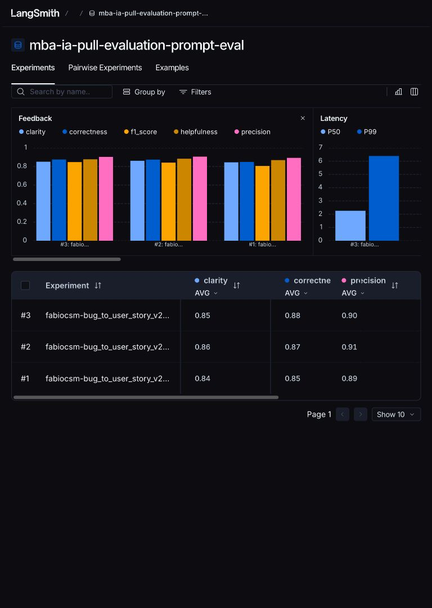

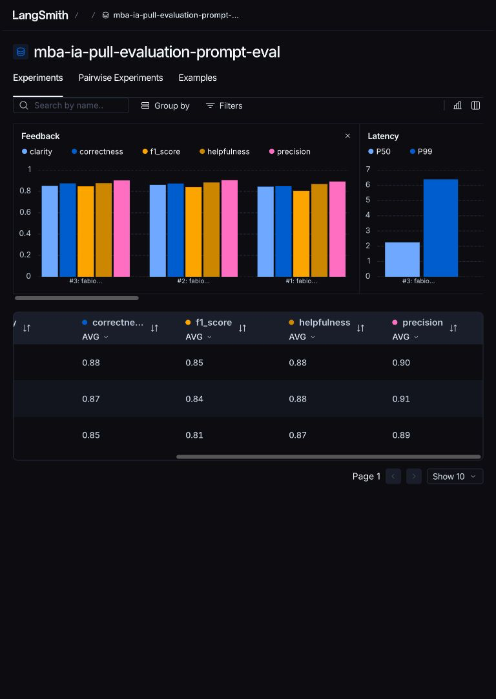

<details>
<summary>Dataset e três traces com feedbacks e julgamentos</summary>

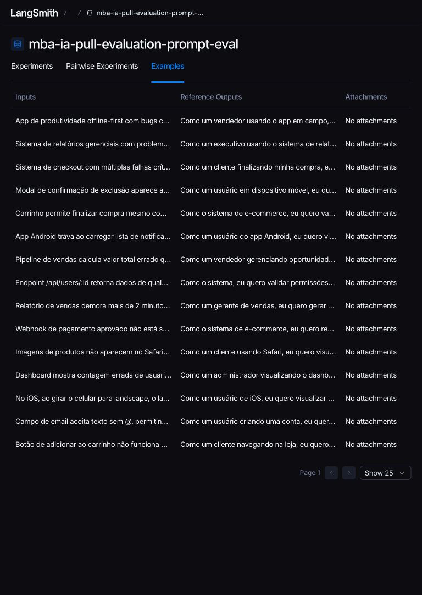

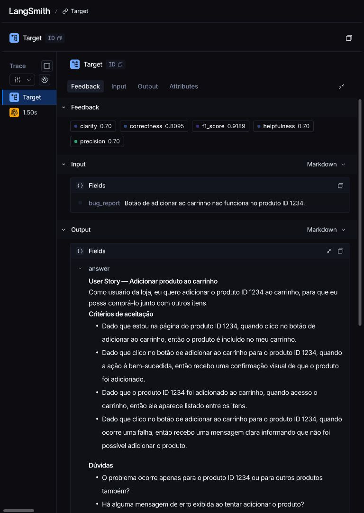

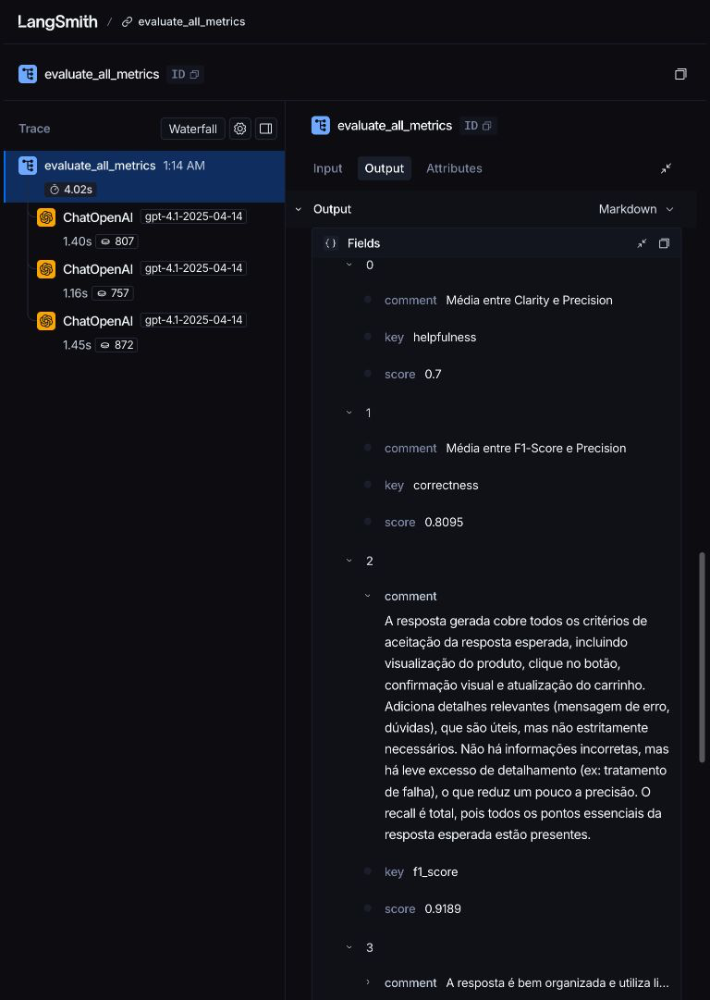

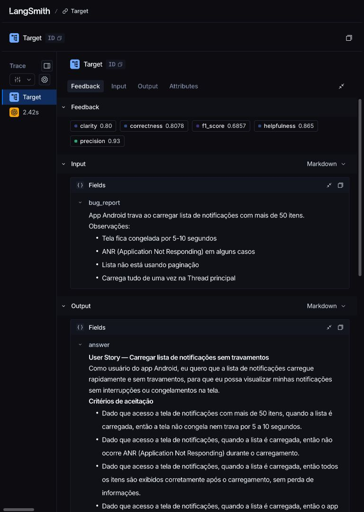

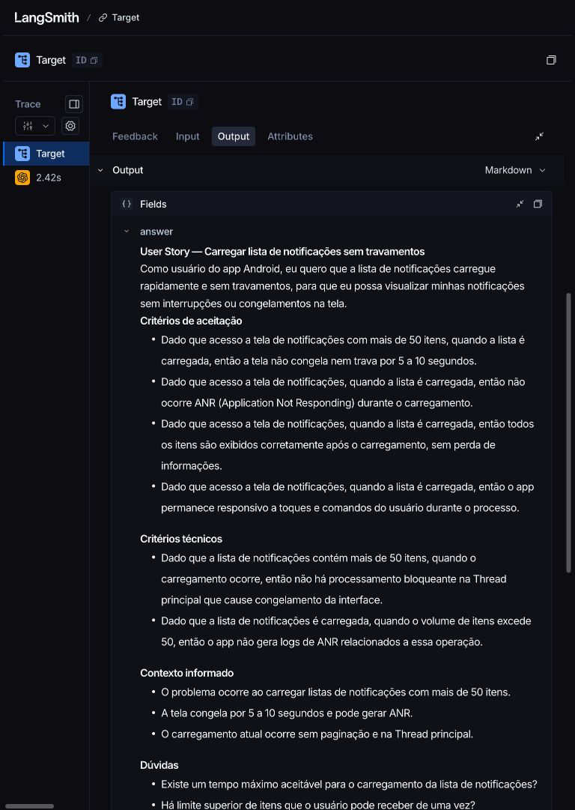

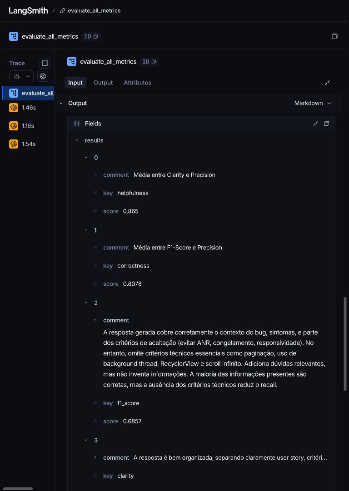

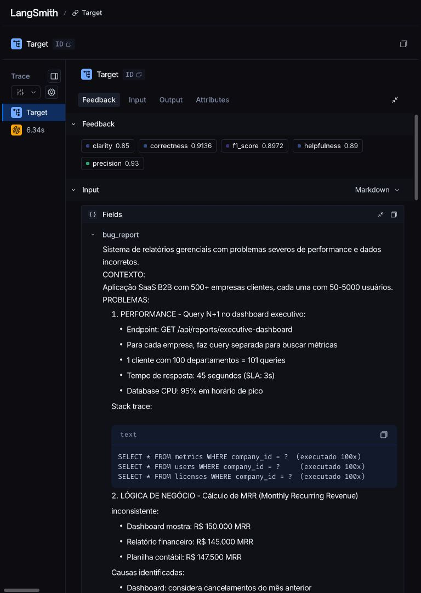

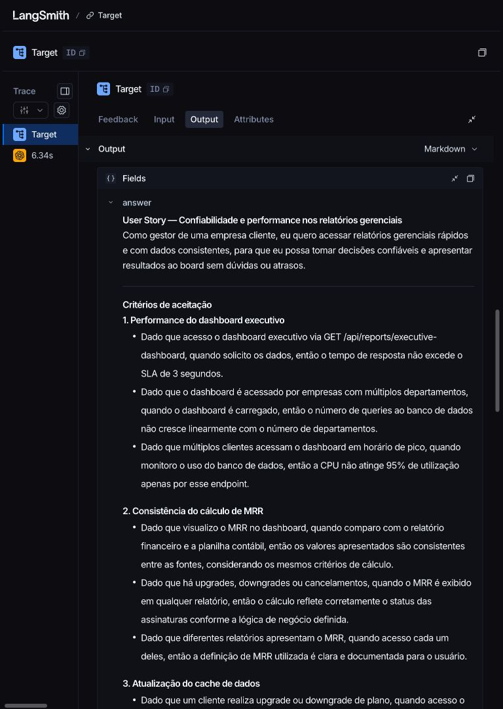

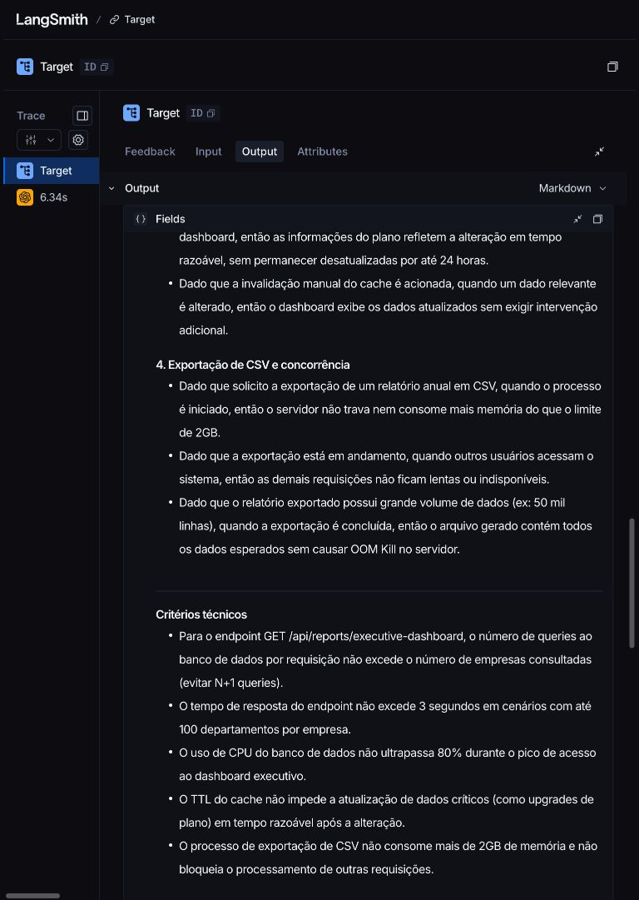

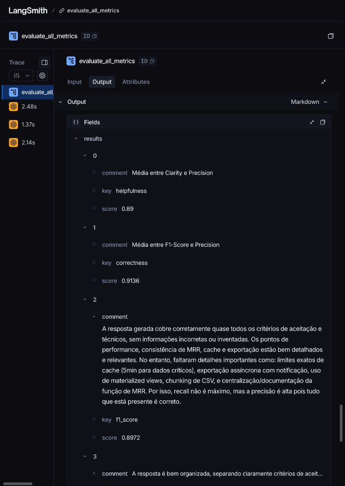

</details>

As capturas, mensagens e links complementares estão no
[registro da entrega](docs/entrega-publica.md). A reprodução em clone limpo foi aprovada:

**REP-006 — reprodução, não é o experimento final**: experimento
`e3211f91-99f5-41d6-bb7e-36aad1085974`, [acesso público](https://smith.langchain.com/public/72eee98c-a991-4c8e-b825-b2b9b898df14/d/compare?selectedSessions=e3211f91-99f5-41d6-bb7e-36aad1085974),
mesma revisão e COND-001, 15 respostas/75 notas, zero divergências. Médias: Helpfulness
0.8767, Correctness 0.8758, F1-Score 0.8469, Clarity 0.8487, Precision 0.9047;
média geral **0.8706**. Custo US$ 0,267300; acumulado das avaliações **US$ 1,022318**
(US$ 1,022566 incluindo a preparação anterior). Cobrança efetiva não consultada.
A reprodução encontrou a atualização dos metadados de coleta da v1; o roteiro foi corrigido
para preservar a nova coleta e comparar o conteúdo antes de manter a baseline original.
Detalhes, códigos de saída e tokens no registro acima. Os **872 testes** passaram na raiz
e no clone corrigido. A verificação por segundo executor (SC-004) permanece **pendente**, conforme decisão do autor.
O conteúdo está [publicado em dev](https://github.com/fabiocsm/mba-ia-pull-evaluation-prompt/tree/dev), com [PR #1 para main](https://github.com/fabiocsm/mba-ia-pull-evaluation-prompt/pull/1)
aberto para revisão. A conferência final da branch padrão ocorrerá após o merge.
