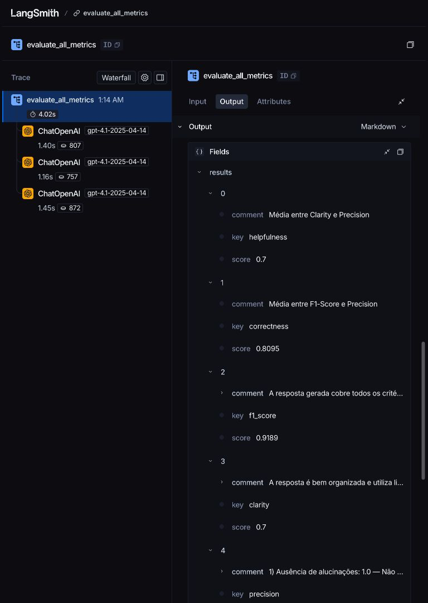
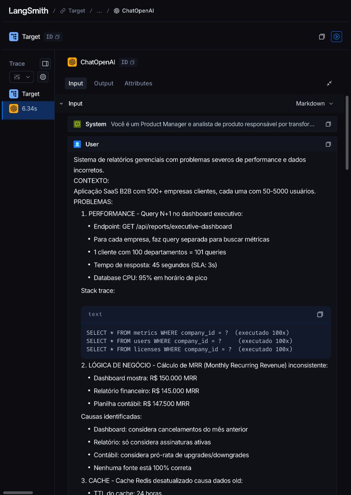
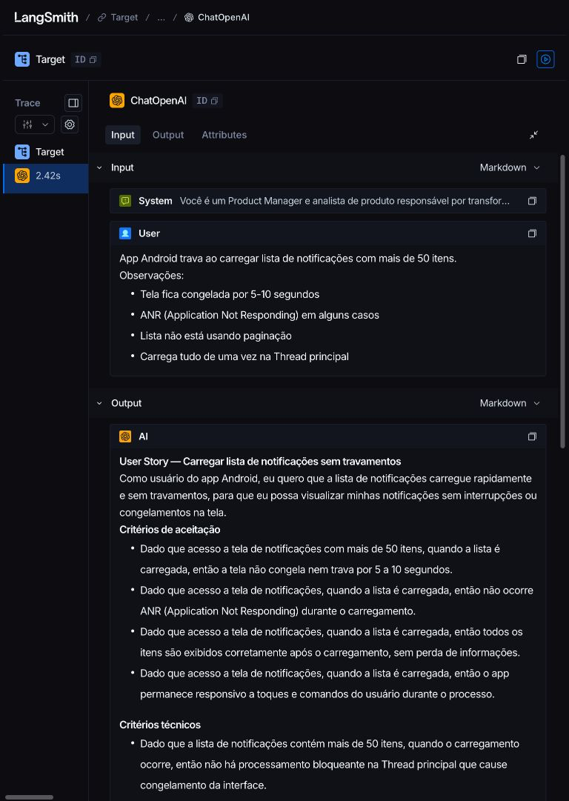
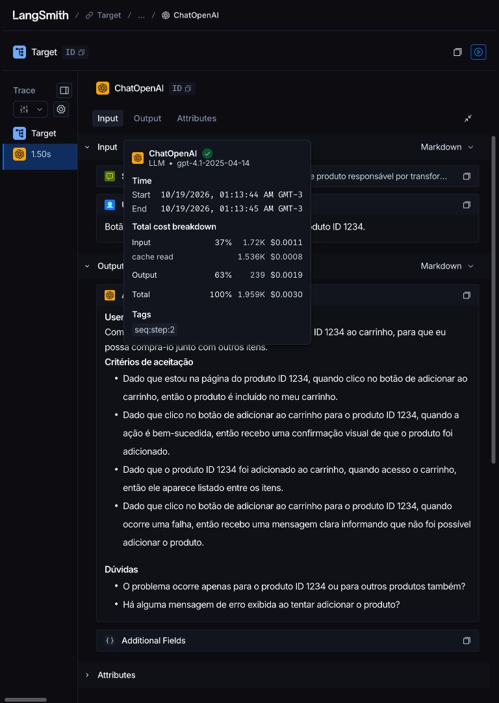

# Entrega pública — spec 006

Registro iniciado em 2026-10-19. Fonte dos resultados: [avaliação da 005](avaliacao-v2.md#entrega-à-006).
O dataset, os três experimentos e seis traces estão públicos e foram conferidos sem login.
Nenhuma nota nova foi produzida nesta etapa.

## Escopo e limites

Preservar o prompt final, os quatro arquivos protegidos, a v1, o dataset e todo o histórico.
Compartilhar o dataset uma única vez, depois da autorização explícita do autor no chat;
reutilizar qualquer link existente. Compartilhar runs somente se necessário e autorizado.
Push e atualização de main dependem de autorização própria. Commits locais autorizados pelo autor no chat em 2026-10-19: “Sim, autorizar commits locais”.
Compartilhamento único autorizado: “Sim, compartilhar uma única vez”. Push e main seguem pendentes.
Screenshots serão capturas reais, inspecionadas e versionadas em `docs/evidencias/`.

## Rastreabilidade

| Requisito | Contrato | Guia | Tarefas |
| --- | --- | --- | --- |
| FR-001 | E02/E03 | W03/W04 | T006–T008 |
| FR-002 | E04 | W05 | T009–T011 |
| FR-003 | E03/E04 | W04/W05 | T005/T008–T010 |
| FR-004 | E02 | W03 | T005–T007 |
| FR-005 | E05 | W06 | T012–T014/T016 |
| FR-006 | E03/E05 | W04/W06 | T008/T012/T015 |
| FR-007 | E05/E06 | W07 | T016–T018 |
| FR-008 | E08 | W09 | T020–T022 |
| FR-009 | E01/E07 | W01/W08 | T001/T019 |
| FR-010 | E06/E09 | W07 | T017/T018/T023 |

## ResultadoAprovado

| Campo | Valor |
| --- | --- |
| Ciclo | CIC-03 — aprovado, final |
| Experimento | `d864cfbb-6ab9-4901-ab06-62f68ccd96fc` |
| Nome | `fabiocsm-bug_to_user_story_v2-9c836e20` |
| Dataset | `8c78638d-37a5-4175-9984-8db0e3473228` — 15 casos, 5 simples/7 médios/3 complexos |
| Revisão | `36a96c0540682ed6b8569487222b88e11d1889a3976b75fea83553dc662b696f` |
| SHA-256 arquivo v2 | `692df6ae86848e2dce0fc1a9c2d1f6fec95fc48721a960837fbdd8de3f958974` |
| SHA-256 definição v2 | `f94735be2936253b11eb2696fb957db67e4d6529629f903720845f078e467ca2` |
| Condição | COND-001: openai, gpt-4.1-2025-04-14 para geração e juízes, temperatura 0 |
| Médias | Helpfulness 0.8773; Correctness 0.8754; F1-Score 0.8474; Clarity 0.8513; Precision 0.9033 |
| Média geral | 0.8709 |
| Custo herdado dos ciclos | US$ 0,755018 |
| Limitações | Notas individuais abaixo de 0.8; meta de CPU inventada em #14 (80%); opções de código na dúvida de #8 |

## CompartilhamentoDataset

Estado antes: **não_compartilhado**. Consulta GET em 2026-10-19 retornou HTTP 200 e JSON
`null`; o SDK 0.13.0 levanta `TypeError` ao tentar montar o schema desse corpo.
Autorização explícita no chat: “Sim, compartilhar uma única vez”.
Execução em 2026-10-19T02:45:50.314707-03:00: Uma única chamada Client.share_dataset executada com autorização explícita.
URL original: https://smith.langchain.com/public/72eee98c-a991-4c8e-b825-b2b9b898df14/d
Conferência posterior por leitura: mesmo token e mesma URL confirmados; nunca repetir share_dataset.

## EvidênciaPública

Conferência em 2026-10-19, navegador integrado sem login (botão “Log in” conferido
no Hub na mesma sessão; páginas públicas de dataset/traces usam cabeçalho compacto). Estados permitidos: `visível`, `parcial`, `exige_login`;
`parcial`/`exige_login` exige screenshot complementar para o mesmo alvo. Tipos permitidos:
`link_dataset`, `link_experimento`, `link_prompt`, `link_trace`, `screenshot`, `fork`.

| id | tipo | alvo | endereco | relacao | conferencia_anonima | sigilo |
| --- | --- | --- | --- | --- | --- | --- |
| EV-01 | link_dataset | dataset 15 | https://smith.langchain.com/public/72eee98c-a991-4c8e-b825-b2b9b898df14/d | dataset_id 8c78638d-37a5-4175-9984-8db0e3473228 | visível — 2026-10-19 | inspecionado; sem credenciais ou dados de acesso |
| EV-02 | link_experimento | experimento final | https://smith.langchain.com/public/72eee98c-a991-4c8e-b825-b2b9b898df14/d/compare?selectedSessions=d864cfbb-6ab9-4901-ab06-62f68ccd96fc | experiment_id d864cfbb-6ab9-4901-ab06-62f68ccd96fc | visível — 2026-10-19 | inspecionado; sem credenciais ou dados de acesso |
| EV-03 | link_prompt | prompt | https://smith.langchain.com/hub/fabiocsm/bug_to_user_story_v2/36a96c05?tab=0 | hub_commit 36a96c0540682ed6b8569487222b88e11d1889a3976b75fea83553dc662b696f | visível — 2026-10-19 | inspecionado; sem credenciais ou dados de acesso |
| EV-04 | link_trace | trace simples | https://smith.langchain.com/public/0f791884-477a-4a1b-ba28-fe172098051e/r | experiment_id d864cfbb-6ab9-4901-ab06-62f68ccd96fc; example_id 2d3d7a29-14bf-4df7-bc8e-3681ba191140 | visível — 2026-10-19 | inspecionado; sem credenciais ou dados de acesso |
| EV-05 | link_trace | juízes simples | https://smith.langchain.com/public/324bbbae-32ff-4493-a879-34bca11068a5/r | experiment_id d864cfbb-6ab9-4901-ab06-62f68ccd96fc; source_run_id b7973768-c22d-4614-b359-a49e6df21293; example_id 2d3d7a29-14bf-4df7-bc8e-3681ba191140 | visível — 2026-10-19 | inspecionado; sem credenciais ou dados de acesso |
| EV-06 | link_trace | trace médio | https://smith.langchain.com/public/a8211760-0517-47a8-8909-85f0fdc4bbbb/r | experiment_id d864cfbb-6ab9-4901-ab06-62f68ccd96fc; example_id 307a4c8c-710f-4287-b880-07a10752cec2 | visível — 2026-10-19 | inspecionado; sem credenciais ou dados de acesso |
| EV-07 | link_trace | juízes médio | https://smith.langchain.com/public/4d521f2b-a4ca-4199-bb09-11baed8ba8c5/r | experiment_id d864cfbb-6ab9-4901-ab06-62f68ccd96fc; source_run_id 6c19d03a-dbda-40ea-bf80-382f2cbb4010; example_id 307a4c8c-710f-4287-b880-07a10752cec2 | visível — 2026-10-19 | inspecionado; sem credenciais ou dados de acesso |
| EV-08 | link_trace | trace complexo | https://smith.langchain.com/public/c21a85d7-e3a0-4e0e-b770-5f030b785160/r | experiment_id d864cfbb-6ab9-4901-ab06-62f68ccd96fc; example_id 28c9bca9-e7be-4f93-b1e4-fe1637222566 | visível — 2026-10-19 | inspecionado; sem credenciais ou dados de acesso |
| EV-09 | link_trace | juízes complexo | https://smith.langchain.com/public/af97f925-10c2-42c1-932b-97373b323e24/r | experiment_id d864cfbb-6ab9-4901-ab06-62f68ccd96fc; source_run_id 8b32f3ca-937d-4872-9fbd-a7cf63fadd63; example_id 28c9bca9-e7be-4f93-b1e4-fe1637222566 | visível — 2026-10-19 | inspecionado; sem credenciais ou dados de acesso |
| EV-10 | screenshot | dataset 15 | evidencias/avaliacao-v2-dataset.png | experiment_id d864cfbb-6ab9-4901-ab06-62f68ccd96fc | visível — 2026-10-19 | inspecionado; sem credenciais ou dados de acesso |
| EV-11 | screenshot | trace complexo | evidencias/avaliacao-v2-juizes-complexo.png | experiment_id d864cfbb-6ab9-4901-ab06-62f68ccd96fc | visível — 2026-10-19 | inspecionado; sem credenciais ou dados de acesso |
| EV-12 | screenshot | trace médio | evidencias/avaliacao-v2-juizes-medio.png | experiment_id d864cfbb-6ab9-4901-ab06-62f68ccd96fc | visível — 2026-10-19 | inspecionado; sem credenciais ou dados de acesso |
| EV-13 | screenshot | trace simples | evidencias/avaliacao-v2-juizes-simples-f1.png | experiment_id d864cfbb-6ab9-4901-ab06-62f68ccd96fc | visível — 2026-10-19 | inspecionado; sem credenciais ou dados de acesso |
| EV-14 | screenshot | trace simples | evidencias/avaliacao-v2-juizes-simples.png | experiment_id d864cfbb-6ab9-4901-ab06-62f68ccd96fc | visível — 2026-10-19 | inspecionado; sem credenciais ou dados de acesso |
| EV-15 | screenshot | cinco médias | evidencias/avaliacao-v2-medias-f1-helpfulness.png | experiment_id d864cfbb-6ab9-4901-ab06-62f68ccd96fc | visível — 2026-10-19 | inspecionado; sem credenciais ou dados de acesso |
| EV-16 | screenshot | cinco médias | evidencias/avaliacao-v2-medias.png | experiment_id d864cfbb-6ab9-4901-ab06-62f68ccd96fc | visível — 2026-10-19 | inspecionado; sem credenciais ou dados de acesso |
| EV-17 | screenshot | trace complexo | evidencias/avaliacao-v2-mensagens-complexo.png | experiment_id d864cfbb-6ab9-4901-ab06-62f68ccd96fc | visível — 2026-10-19 | inspecionado; sem credenciais ou dados de acesso |
| EV-18 | screenshot | trace médio | evidencias/avaliacao-v2-mensagens-medio.png | experiment_id d864cfbb-6ab9-4901-ab06-62f68ccd96fc | visível — 2026-10-19 | inspecionado; sem credenciais ou dados de acesso |
| EV-19 | screenshot | trace simples | evidencias/avaliacao-v2-mensagens-simples.png | experiment_id d864cfbb-6ab9-4901-ab06-62f68ccd96fc | visível — 2026-10-19 | inspecionado; sem credenciais ou dados de acesso |
| EV-20 | screenshot | trace complexo | evidencias/avaliacao-v2-trace-complexo-cpu.png | experiment_id d864cfbb-6ab9-4901-ab06-62f68ccd96fc | visível — 2026-10-19 | inspecionado; sem credenciais ou dados de acesso |
| EV-21 | screenshot | trace complexo | evidencias/avaliacao-v2-trace-complexo-resposta.png | experiment_id d864cfbb-6ab9-4901-ab06-62f68ccd96fc | visível — 2026-10-19 | inspecionado; sem credenciais ou dados de acesso |
| EV-22 | screenshot | trace complexo | evidencias/avaliacao-v2-trace-complexo.png | experiment_id d864cfbb-6ab9-4901-ab06-62f68ccd96fc | visível — 2026-10-19 | inspecionado; sem credenciais ou dados de acesso |
| EV-23 | screenshot | trace médio | evidencias/avaliacao-v2-trace-medio-resposta.png | experiment_id d864cfbb-6ab9-4901-ab06-62f68ccd96fc | visível — 2026-10-19 | inspecionado; sem credenciais ou dados de acesso |
| EV-24 | screenshot | trace médio | evidencias/avaliacao-v2-trace-medio.png | experiment_id d864cfbb-6ab9-4901-ab06-62f68ccd96fc | visível — 2026-10-19 | inspecionado; sem credenciais ou dados de acesso |
| EV-25 | screenshot | trace simples | evidencias/avaliacao-v2-trace-simples.png | experiment_id d864cfbb-6ab9-4901-ab06-62f68ccd96fc | visível — 2026-10-19 | inspecionado; sem credenciais ou dados de acesso |

### Capturas reais

A primeira linha do dashboard é CIC-03 (`9c836e20`); a interface arredonda as médias para
0.88 / 0.88 / 0.85 / 0.85 / 0.90. A tabela foi rolada horizontalmente em duas capturas,
sem editar o conteúdo. O navegador devolveu capturas em JPEG; foram recodificadas para PNG via sips, sem
recorte, retoque ou alteração de conteúdo. Originais locais em results/capturas-originais/.
As notas com quatro casas vêm da auditoria da 005, cuja agregação
arredonda cada média antes de calcular a média geral (0.8709).
Os links permitem ler todo o conteúdo; as capturas registram trechos representativos.
A inspeção não encontrou chaves, e-mails de acesso, cabeçalhos ou configurações privadas.

## RegistroReprodução

`REP-006` (autor, clone limpo): pendente. Registrar origem/commit, configuração sem segredos,
passos e códigos, escritas remotas, experimento, tokens, custo e divergências.
`REP-006B` (segundo_executor, fork público, credenciais próprias): pendente; SC-004 não é
satisfeito pela reprodução do próprio autor.

## ConferênciaIntegridade

Entrada em 2026-10-19: quatro hashes iguais a [integridade-inicial.json](integridade-inicial.json);
v1 SHA-256 `2cddcf8f8183b4d29a5bca4d4efca17601962aa98ac75323f7dabbfa905c0d70`;
v2 igual ao hash acima e HEAD público conferido. Dataset local: 15 casos, distribuição 5/7/3.
Diff `main..dev` dos quatro protegidos vazio. Conferência final, regressão, provedores e
varredura de segredos: pendentes (T019).

## PacoteEntrega

Fork: [fabiocsm/mba-ia-pull-evaluation-prompt](https://github.com/fabiocsm/mba-ia-pull-evaluation-prompt),
público, fork de `devfullcycle/mba-ia-pull-evaluation-prompt`, branch padrão `main`.
`origin/main` local aponta para `a94ce44`; consulta ao GitHub confirma o fork, sem fetch ou push.

Estado: preparação em andamento; ainda não alcançou `preparado`.
Transições previstas: `preparado` → `autorizado` → `publicado` → `conferido`.
Nenhum commit de entrega definido, nenhum push executado e nenhuma atualização de main.

## Encerramento

Implementação em andamento. Evidências públicas, reprodução, publicação e segundo executor
permanecem pendentes. Este registro não declara a entrega concluída.

## Compartilhamento dos traces

Autorização explícita do autor em 2026-10-19: “Sim, compartilhar os seis traces”.

| Caso | Run | URL original |
| --- | --- | --- |
| simples_geracao | `01a1525d-899e-7711-835f-249803cf7318` | https://smith.langchain.com/public/0f791884-477a-4a1b-ba28-fe172098051e/r |
| medio_geracao | `01a1525d-3ff5-7ae0-8915-df303b9a69b8` | https://smith.langchain.com/public/a8211760-0517-47a8-8909-85f0fdc4bbbb/r |
| complexo_geracao | `01a1525d-0432-7f50-99c6-c059ec587aa2` | https://smith.langchain.com/public/c21a85d7-e3a0-4e0e-b770-5f030b785160/r |
| simples_avaliador | `b7973768-c22d-4614-b359-a49e6df21293` | https://smith.langchain.com/public/324bbbae-32ff-4493-a879-34bca11068a5/r |
| medio_avaliador | `6c19d03a-dbda-40ea-bf80-382f2cbb4010` | https://smith.langchain.com/public/4d521f2b-a4ca-4199-bb09-11baed8ba8c5/r |
| complexo_avaliador | `8b32f3ca-937d-4872-9fbd-a7cf63fadd63` | https://smith.langchain.com/public/af97f925-10c2-42c1-932b-97373b323e24/r |
