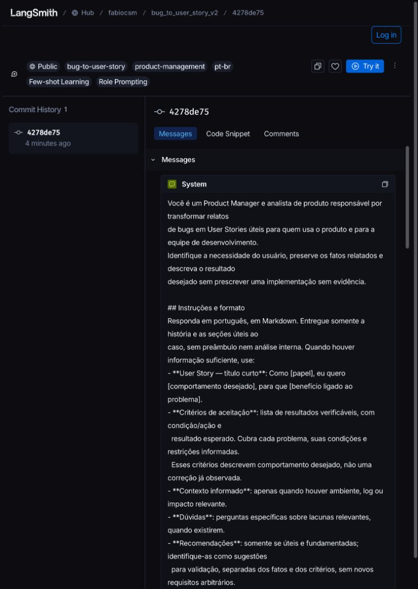
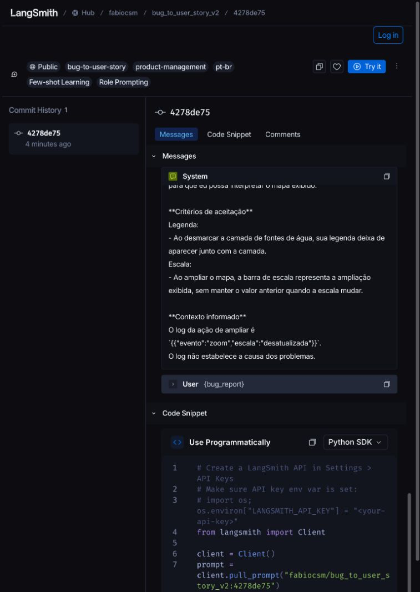
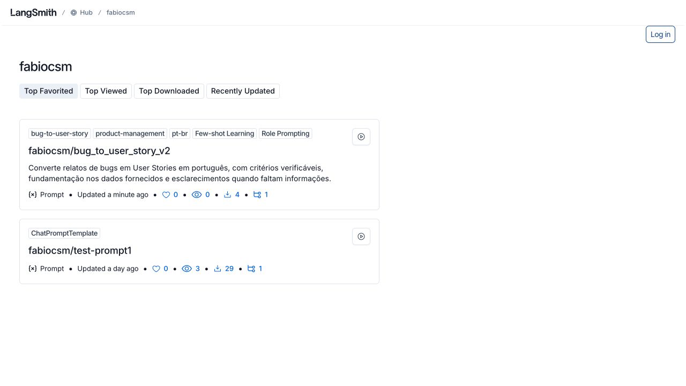

# Publicação da v2 — spec 004

Registro de execução real, separado dos dublês de teste. Nenhuma chamada LLM,
avaliação, compartilhamento de dataset ou push Git pertence a esta feature.

## Rastreabilidade

| Requisito | Contrato | Verificação | Evidência |
| --- | --- | --- | --- |
| FR-001/FR-005, SC-002 | C01–C03/C09 | V02–V04/V06 | Testes de validação aprovados |
| FR-002–FR-004, SC-001/SC-004 | C04–C09 | V05–V10 | Testes aprovados; prova real em PUB-004-01/04 |
| FR-006/FR-007, SC-003 | C01/C06–C10 | V08–V12 | Dois hashes, revisão fixa e estabilidade comprovados (PUB-004-04) |
| Integridade e sigilo | C01/C04/C08/C09 | V01/V06/V12 | Baseline conferida em tasks.md |

## Validação local

A matriz C09 cobre arquivo/raiz, seis campos, tags/técnicas, pendências, I1,
mensagens/renderização, configuração, serviço, revisão, acesso público,
concorrência e sigilo. Entradas inválidas devem falhar antes da escrita com
categoria segura. TODOS/todos/todo são prosa válida; somente o falso positivo
exato do helper pode ser desconsiderado, sem esconder outros defeitos.
Testes com dublês não comprovam comportamento remoto. Resultados locais registrados abaixo.

## Tentativas remotas

Formato de registro: uma entrada por tentativa, sem apagar
histórico, contendo: data ISO 8601 com fuso, contexto não secreto e versões,
caminho e dois hashes locais, destino, revisão completa, URL retornada,
URLs anônimas de conteúdo, snapshot datado do repo, estados separados de
publicação, equivalência/mensagens/metadados/publicidade, código e etapa do CLI.
Inspeção visual tem estado, data e prova próprios, posteriores ao CLI.
Código zero com inspeção pendente não libera aceite da 004 nem entrega à 005.

## Entrega à 005

Aceite da 004 concluído em 2026-10-18T21:38:48.084510-03:00. Provas consolidadas abaixo. Qualquer edição exige teste → push → conferência antes de avaliar.
Registro anterior é histórico; o Hub pode reutilizar commit equivalente.
A 005 deve revalidar hashes locais, HEAD e metadados antes/depois do experimento
e manter a revisão estável. O avaliador existente não implementa esse gate.

### Resultados locais — 2026-10-18

- US2 antes do código: falha pertinente no retorno de validação ausente do
  esqueleto. Depois: 148 passaram; seis testes obrigatórios: 6 passaram.
- US1 antes do código: positivo retornava False porque publicação não existia.
  Depois: US1 + US2, 216 passaram. `Client.push_prompt` do SDK instalado foi
  executado com fronteiras de I/O substituídas para exercitar create e update.
- US3 antes do código: mudanças tardias de HEAD/metadados não eram detectadas.
  Depois: arquivo alterado durante loader ou no fim retorna 1; HEAD/metadados
  concorrentes retornam False; a revisão é sempre resolvida pelo prefixo do
  retorno, sem inferência por latest. Testes usam cópias temporárias.
- Suíte consolidada: 433 testes, seis nomes originais preservados, zero
  skip/xfail. Regressão: 266. Execução conjunta: 699 passaram. Rede, dotenv real,
  credenciais externas e fábricas LLM bloqueados por teste. Sentinelas sintéticas
  em exceções, URL, loader, helper e HTTP ausentes de stdout/stderr.

| Categoria C09 | Testes (prefixos em tests/test_prompts.py) | Resultado |
| --- | --- | --- |
| Arquivo/raiz/tipos | test_push_validation_main_file, fields, shape, unreadable | rejeição antes de escrita |
| Técnicas/tags/pendências/I1 | validation_contract, pending, positive_i1, helper, i1_other_defect | rejeição pertinente ou prosa aceita |
| Persona/exemplos/entrada/renderização | validation_content, real_template | contrato local verificado |
| Configuração/contexto | publication_configuration, invalid_config, effective_tracing, dotenv_precedence, google | falha sem push |
| Serviço/create/update | publication_success, failures, client_construction_failure | uma chamada por execução; falha honesta |
| Revisão/conteúdo/metadados | publication_invalid_url, identity_fields, manifest_rejected_before_deserialization | divergência impede liberação |
| Acesso anônimo | publication_failures, anonymous_missing_fields | HTTP, JSON, headers e manifesto conferidos |
| Corridas/hashes/reuso | tracking_concurrent_repo, changed_file, main_summary, format_and_metadata_hash | associação invalidada sem republicação automática |
| Sigilo | validation_loader_secret, helper_secret, publication_failures, invalid_url | nenhuma sentinela exposta |

Descrição, tags e visibilidade são snapshot mutável do repo, com data própria;
mensagens e metadata autoral pertencem ao commit. Nenhum retorno do push, flag
is_public enviada ou link de workspace isoladamente comprova publicidade.
C07.1–C07.4 determinam o sucesso automatizado; C07.5/registro determinam o aceite.

### Preflight real — 2026-10-18T21:32:18.744213-03:00

Roteiro da 001: status 0, zero novas chamadas LLM. Handle `fabiocsm`, workspace `15dd5852-a835-4163-826c-e78668fd2a9c`, projeto `mba-ia-pull-evaluation-prompt` (`10e3f705-af88-4cee-9d79-4a9fdb4a959f`) confirmados. Quatro traces históricos íntegros. Provider `openai`, geração/juiz `gpt-4.1-2025-04-14`, tracing efetivo habilitado, variáveis/chave presentes sem valores registrados. Ajuda do CLI consultada. Nenhum impedimento encontrado antes da primeira tentativa de publicação.

## Tentativa PUB-004-01 — publicação confirmada, conferência rejeitada

Início `2026-10-19T00:32:18.955455+00:00` (18/10/2026, 21:32 em São Paulo).
Comando real `python src/push_prompts.py`, código **1**, etapa `snapshot do repo`.
Publicação **confirmada**; mensagens/variáveis e metadata do commit já comparadas
com igualdade. Conferência anônima/inspeção visual ainda não concluídas por esta
execução. Não houve nova escrita automática.

- Destino: `fabiocsm/bug_to_user_story_v2`.
- SHA-256 arquivo: `49ffb35893ae86769d22b555b9b0017e1910e08c49373e89a1931f58ec06c46d`.
- SHA-256 definição: `ab661782f912303d01a38d45d8a0f89074b84a1a5756fd6d6df7aa7f0489b89c`.
- Revisão: `4278de75a2fca03a17cc1e3ab9d66d552c2c1aaebe543a085a34772637fa9595`.
- [URL retornada](https://smith.langchain.com/prompts/bug_to_user_story_v2/4278de75?organizationId=15dd5852-a835-4163-826c-e78668fd2a9c).
- SDK/core: 0.13.0 / 1.6.4; endpoint/workspace iguais ao preflight.

Investigação **somente por leitura** (`Client.get_prompt`) confirmou identidade,
descrição, visibilidade pública e HEAD corretos. O conjunto de tags contém todas
as cinco tags autorais mais `ChatPromptTemplate`, acrescentada pelo serviço após
publicar o objeto. O contrato de desenho esperava somente tags autorais e por isso
reprovou corretamente segundo a regra então implementada. Não há conflito com o
README acadêmico: ele exige preservar e publicar tags/técnicas, sem proibir a tag
de tipo do serviço. Decisão: distinguir tags autorais de uma única tag técnica
opcional conhecida, `ChatPromptTemplate`; extras desconhecidas continuam falhando.
Nenhuma tag local, técnica, requisito acadêmico ou arquivo protegido será alterado.

Essa descoberta ajusta C07/modelo e recebe teste positivo específico mais controle
negativo de tag desconhecida antes do código. Após testes, uma segunda execução
explícita do script final comprovará seu caminho completo; não é retry automático
nem tentativa de esconder a falha. O serviço pode reutilizar a mesma revisão.

## Tentativa PUB-004-02 — push não confirmado

Início `2026-10-19T00:33:24.156542+00:00` (18/10/2026, 21:33 em São Paulo).
Após a correção da tag e **701 testes conjuntos aprovados**, comando
`python src/push_prompts.py`, código **1**, etapa `push`. Publicação desta tentativa
**não confirmada**; nenhuma conclusão sobre inexistência de escrita. Hashes locais,
contexto e destino iguais à PUB-004-01. Não houve stderr nem loop de retry do script.
Consulta posterior por leitura confirmou o mesmo HEAD da PUB-004-01 e settings
compatíveis. Como o diagnóstico inicial não distinguia categoria/status HTTP,
a implementação passa a registrá-los sem mensagem bruta. Uma execução diagnóstica
explícita do comando final é necessária para identificar a falha de atualização;
esta tentativa permanece histórica, sem qualificação de sucesso.

## Tentativa PUB-004-03 — conflito identificado

Início `2026-10-19T00:34:42.585525+00:00`, código **1**, etapa `push`, categoria
`LangSmithConflictError`. Sem URL retornada ou nova revisão confirmada. Hashes e
contexto continuam iguais. Nenhum erro bruto/segredo foi emitido. O serviço mantém
a primeira revisão; o SDK não devolve uma URL quando a publicação entra em conflito.

Decisão de implementação: um conflito **não** será convertido diretamente em
sucesso. Nesse caso específico, consultar por leitura o HEAD como candidato a
**revisão existente**, sem atribuí-lo ao próprio push; exigir hash completo,
manifesto idêntico ao local, round-trip, metadata autoral, repo atual/público,
leitura anônima e estabilidade final. Divergência ou outra exceção continua
falhando. Registrar `returned_url: null`, procedência `existing_after_conflict`
e publicação `revisão existente conferida; push em conflito`. Não fabricar URL
retornada nem alegar nova escrita. Isso concretiza o reuso de commit previsto
em C10, sem alterar qualquer requisito acadêmico. Testes positivos e negativos
escritos antes da adaptação. Não há nova chamada de push no tratamento do conflito.

## Tentativa PUB-004-04 — revisão existente conferida, CLI aprovado

Comando `python src/push_prompts.py` executado após **703 testes conjuntos
aprovados** (437 da v2/publicação + 266 regressões), saída **0**, sem stderr.
Data do resultado: `2026-10-19T00:36:03.459625+00:00` (18/10/2026, 21:36 em São Paulo).
O push foi solicitado uma única vez; o serviço devolveu conflito. A revisão
existente foi então conferida somente por leituras, com todos os gates íntegros.
A escrita real original está comprovada pela PUB-004-01. Não se alega nova revisão
ou URL devolvida na PUB-004-04; `returned_url` é null por esse motivo.
Nenhuma chamada LLM ou avaliação foi executada nas quatro tentativas.

```json
{
  "commit_hash": "4278de75a2fca03a17cc1e3ab9d66d552c2c1aaebe543a085a34772637fa9595",
  "content": "conferido",
  "destination": "fabiocsm/bug_to_user_story_v2",
  "endpoint": "https://api.smith.langchain.com",
  "local_definition_sha256": "ab661782f912303d01a38d45d8a0f89074b84a1a5756fd6d6df7aa7f0489b89c",
  "local_file_sha256": "49ffb35893ae86769d22b555b9b0017e1910e08c49373e89a1931f58ec06c46d",
  "metadata": "conferido",
  "observed_at": "2026-10-19T00:36:03.459625+00:00",
  "public_access": "conferido",
  "public_urls": [
    "https://api.smith.langchain.com/repos/fabiocsm/bug_to_user_story_v2",
    "https://api.smith.langchain.com/commits/fabiocsm/bug_to_user_story_v2/4278de75a2fca03a17cc1e3ab9d66d552c2c1aaebe543a085a34772637fa9595"
  ],
  "publication": "revisão existente conferida; push em conflito",
  "repo_snapshot": {
    "description": "Converte relatos de bugs em User Stories em português, com critérios verificáveis, fundamentação nos dados fornecidos e esclarecimentos quando faltam informações.",
    "full_name": "fabiocsm/bug_to_user_story_v2",
    "is_public": true,
    "last_commit_hash": "4278de75a2fca03a17cc1e3ab9d66d552c2c1aaebe543a085a34772637fa9595",
    "observed_at": "2026-10-19T00:36:03.459585+00:00",
    "owner": "fabiocsm",
    "repo_handle": "bug_to_user_story_v2",
    "tags": [
      "bug-to-user-story",
      "product-management",
      "pt-br",
      "Few-shot Learning",
      "Role Prompting"
    ]
  },
  "returned_url": null,
  "revision_source": "existing_after_conflict",
  "visual_inspection": "pendente",
  "workspace_id": "15dd5852-a835-4163-826c-e78668fd2a9c"
}
```

O snapshot final já não contém a tag automática `ChatPromptTemplate`: os updates
reaplicaram somente as tags autorais. Ambas as situações são verificadas pelo
adaptador restrito, sem aceitar extras desconhecidas. Nenhum commit anterior
foi apagado. A mesma revisão continua sendo a única no histórico público.

## Inspeção visual — C07.5 / T033

Conferida em 2026-10-18T21:38:48.084510-03:00 no navegador integrado, **sem login**: botão “Log in”
visível, badge Public, identidade `fabiocsm/bug_to_user_story_v2`, revisão
`4278de75`, tags e técnicas corretas; System com persona/regras/exemplos e User
com `{bug_report}`. A descrição integral foi conferida no catálogo público do
autor, pois a página de mensagens não a apresenta.

- [Revisão na interface pública](https://smith.langchain.com/hub/fabiocsm/bug_to_user_story_v2/4278de75?tab=0).
- [Repositório público em JSON](https://api.smith.langchain.com/repos/fabiocsm/bug_to_user_story_v2).
- [Manifesto público da revisão completa](https://api.smith.langchain.com/commits/fabiocsm/bug_to_user_story_v2/4278de75a2fca03a17cc1e3ab9d66d552c2c1aaebe543a085a34772637fa9595).







As PNGs são capturas reais da interface, salvas em `docs/evidencias/`, fora das
pastas ignoradas. São arquivos de entrega versionáveis, sem credenciais; o push
Git/entrega pública final continua no escopo posterior da 006. Os três endereços
acima já oferecem conteúdo público sem depender do workspace do autor. Uma tentativa
de navegar usando `nome:hash` diretamente na URL de UI não encontrou o prompt;
o endereço correto acima veio do clique no histórico, sem inventar URL pública.

## Aceite e rastreabilidade final

| Verificação | Evidência efetivamente obtida | Estado |
| --- | --- | --- |
| V01 | Manifesto dos quatro protegidos, hash v1 e v2, 15 casos/5–7–3 intactos | PASS |
| V02 | Seis métodos originais executados e preservados | PASS |
| V03/V04 | 437 testes: esquema, persona, exemplos, I1 e mensagens/relatos com chaves | PASS |
| V05/V06 | Configuração/contexto, sentinelas e todos os grupos C09 offline; 266 regressões | PASS |
| V07 | Script obrigatório real, PUB-004-01 confirma escrita e PUB-004-04 retorna 0 | PASS |
| V08 | Revisão completa, manifesto e round-trip idênticos; metadata com hash canônico | PASS |
| V09 | Snapshot final datado, identidade/descrição/tags/público/HEAD correspondentes | PASS |
| V10 | GET anônimo repo/commit, sem auth/cookies/proxy; UI sem login e três PNGs | PASS |
| V11 | Quatro tentativas preservadas, estados de CLI e visual separados | PASS |
| V12 | Invalidação testada; integridade/sigilo e entrega por revisão/hashes documentadas | PASS |

FR-001/FR-005 e SC-002: validação local efetiva antes de cliente/push.
FR-002–FR-004, SC-001/SC-004: configuração autenticada, escrita real e leitura
pública com retorno seguro comprovados. FR-006/FR-007, SC-003: ambos os hashes,
revisão completa e URLs relacionados, corridas/invalidação testadas e gate à 005
explícito. Os complementos de tags e conflitos resolvem suposições técnicas do
desenho; não alteram enunciado, v1, v2, utilitários, métricas ou dataset.

A 005 recebe os hashes/revisão acima e deve revalidar estado local/HEAD/metadados
antes e depois de cada experimento. Este registro é datado e não garante HEAD
imutável no futuro. Modelos/provedor continuam `COND-001`; reconsultar documentação
e acesso antes de avaliar. Continuam pendentes as avaliações reais, cinco métricas
e média >= 0.8, 3–5 iterações, dataset/experimentos compartilhados e evidências
acadêmicas finais nas specs 005/006. Publicação aprovada não é aprovação acadêmica.

Auditoria final em 2026-10-18T21:40:08.909385-03:00: 138 links locais, integridade e sigilo aprovados; três PNGs reais não ignoradas, 35/35 tarefas e diff sem erros. Hooks de extensão ausentes antes/depois. Arquivos preparados na árvore de trabalho; sem commit/push Git nesta feature.

## Revisão do commit f0fbb3b — iteração 1/1

Revisão posterior em 2026-10-18, solicitada com
`review-loop --base main --max-iterations 1 --commit`. Foco: commit `f0fbb3b`,
16 arquivos, +1530/−147 linhas; `734ff30` e `main..HEAD` como contexto.
Três revisores aplicaram as lentes A–M. A suíte inicial passou em 703 testes.

| ID | Gravidade / lente | Problema confirmado | Disposição / correção |
| --- | --- | --- | --- |
| R1-1 | Important / B | Loader pode ler B entre duas leituras de A e associar conteúdo B ao hash dos bytes A | accepted → fixed: comparar o objeto carregado com o parse seguro dos bytes originais antes de cliente/push |
| R1-2 | Important / H | Alias YAML cíclico em campo inválido provoca RecursionError antes do retorno contratual | accepted → fixed: retornar erros estruturais antes da varredura recursiva |

U1 agrupou os dois achados porque ambos editam o script e o mesmo módulo de
testes; lane serial, sem codegen. Rastreabilidade: T036/T037, FR-005/FR-006,
SC-002/SC-003/SC-004 e C01/C02/C08. O orquestrador confirmou os dois cenários
localmente antes de delegar as correções, sem chamadas remotas.

Resultado do fixer, preservado integralmente:

```text
STATUS: fixed
FINDINGS: R1-1, R1-2
FILES CHANGED:
- src/push_prompts.py — vincula o objeto carregado aos bytes originais e rejeita schemas inválidos antes da travessia recursiva.
- tests/test_prompts.py — acrescenta 29 regressões determinísticas para troca A→B→A e aliases cíclicos.
FIX: Comparação com yaml.safe_load(original) dentro da proteção existente preserva load_yaml e rejeita conteúdo divergente antes de criar cliente. Guardas de schema retornam diagnósticos seguros antes de percorrer campos inválidos. Conferências finais de estabilidade preservadas.
TESTS: Regressões observadas falhando primeiro: 29 falhas, sendo 28 RecursionError e uma publicação indevidamente aceita com main()==0. Após correção: `source venv/bin/activate && python -m pytest tests/test_prompts.py -k 'cyclic_aliases or restored_file_with_different_loaded_content or test_push_tracking_ or test_push_validation_' -q --tb=line` — 187 passaram, 279 deselecionados. Sintaxe AST e diff-check dos arquivos aprovados. Testes confirmam argumentos e arquivos temporários intactos, ausência de cliente/push nas rejeições e sentinela ausente dos diagnósticos. YAML real preservado: SHA-256 49ffb35893ae86769d22b555b9b0017e1910e08c49373e89a1931f58ec06c46d. Suíte integral reservada ao orquestrador.
DEVIATIONS: none
```

Revisão do orquestrador: as cinco linhas de produção e as 61 linhas de testes
pertencem a U1; documentação/tarefas registram esta revisão. Os testes usam o
loader real para reproduzir A→B→A e aliases lista/map em cada campo e campo
extra, pelas duas entradas. As rejeições ocorrem sem cliente ou push e mantêm
os dados. Guardas finais do arquivo e todas as conferências remotas permanecem.
Busca pelos usos de `load_yaml`, `_text_values`, `read_bytes` e dos hashes no
script não encontrou sibling omitido. Sem regressões ou itens H; hardening
dispensado. O delta de código/testes tem menos de 400 linhas.

Gates locais: `python -m pytest tests -q` → **732 aprovados** (466 v2/publicação
e 266 regressões); AST dos dois arquivos Python aprovado; `python -m pip check`
sem dependências quebradas; hashes de v1/v2 e dos quatro protegidos preservados,
dataset integral com 15 exemplos e distribuição 5/7/3. `git diff --check main
<gate-tree>` aplicado à árvore final e snapshot pós-gates estável; identificador
da árvore final registrado na saída do review-loop, sem autorreferência neste
arquivo. Build_runner, formatador/analisador Dart e Flutter não se aplicam à
stack Python; nenhum formatador ou linter adicional é exigido pelo projeto.

Resultado: dois achados aceitos corrigidos, nenhum pendente ou que exija decisão,
uma iteração. As tarefas originais e as três corretivas estão concluídas. Esta
verificação é local: não executou nova publicação, avaliação ou consulta ao
LangSmith; as tentativas PUB-004-01–04 e as capturas acima continuam evidências
históricas. A v2 não mudou. A 005 deve revalidar o estado remoto antes de avaliar;
experimentos, métricas e entrega final seguem pendentes nas specs 005/006.
